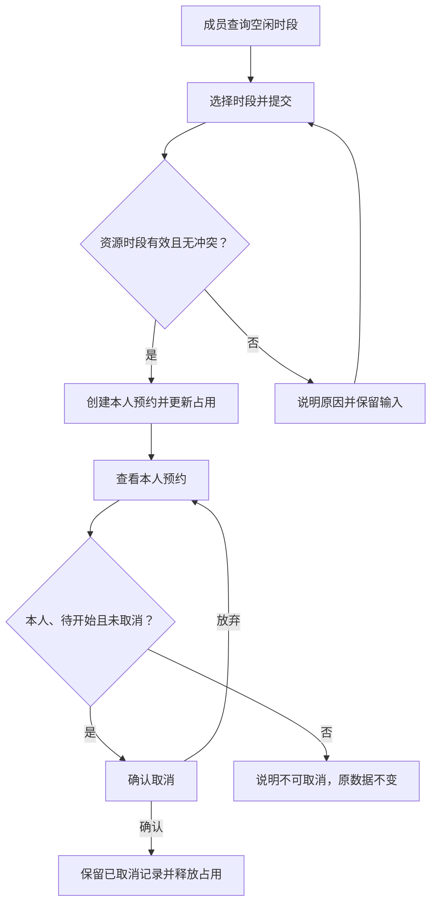

# 完整案例：从预约方向到业务模型与局部变更

这是自行编写的虚构案例，不是通用预约规范。仅分析业务即可完整使用本 Skill，不依赖页面或另一个 Skill。

## 输入与调用

```text
使用 hannes-product-modeling 的 model 模式。
成员查询共享资源的预设空闲时段并预约，只能查看和取消自己的预约。
不涉及审批或资源维护；只有成员角色。失败保留输入，不产生预约记录。
本人只能取消尚未开始的预约，取消释放占用，重复取消不重复释放。
示例时钟固定为 2030-06-18 09:00（UTC+08:00），时段为半开区间。
请将模型和已确认规则保存到项目已有说明，不设计页面。
```

## 范围与决定

核心任务为查空闲、创建本人预约、查看与取消。只纳入资源、时段、预约及必要校验；不加入管理员、审批、通知、退款、资源维护或登录。预设数据由演示提供，不推导维护岗位。

查空闲所需的投影至少包含资源、开始／结束、占用与是否开放；本人历史记录不等于公共可用性。未开放／未知区间不能推导为空闲；筛选不修改占用事实。该边界供任意页面表达复用，不绑定甘特或某个控件。

资源和时段是可选条件，预约是事实记录；占用由未取消的有效预约推导，不维护另一份人工库存。同一人工角色完成多个步骤，系统负责自动校验，但不是新增人工角色。

## 模型与规则（初版有效）

| 对象 | 关键内容与关系 |
| --- | --- |
| 资源 | 稳定标识、名称；具有多个预设时段 |
| 时段 | 稳定标识、资源、开始／结束；开始早于结束，明确时区 |
| 预约 | 稳定标识、时段、成员、状态；一个预约关联一个时段和一个成员 |
| 空闲结果 | 从资源及时段与有效预约计算，非独立维护对象 |

- R1：仅本人预约可读取和取消；公共可用性只显示已占用，不泄露其他成员身份或用途。
- R2：创建时重新检查资源及未来时段是否有效；同一资源有活动预约区间重叠则拒绝。重叠公式为 `a.start < b.end && b.start < a.end`；首尾相接不重叠。
- R3：预约状态为 `booked`／`cancelled`；初版取消条件为本人、`booked`、`now < start`。
- R4：取消改为 `cancelled`，保留记录；空闲结果即时重算。重复取消不重复改变事实。
- R5：失败不产生新记录，不改变旧占用；已输入内容保留。规则与示例数据共用固定示例时钟。



## 一项局部变更

后续输入：取消条件改成开始前至少 60 分钟，恰好 60 分钟允许；其他规则不变。

在实际项目中直接替换 R3 的时间条件为 `start - now >= 60 分钟`，仍要求本人和 `booked`。同时更新图中判断、动作规格及边界验收，不另建一份有效 R3。这里保留前后版本只是教学对照，不能将两者同时作为项目有效规则。

影响为取消可执行性、提示、占用释放触发条件、相关流程判断与验证；不改变可读范围、预约创建条件或角色，不追加审批。09:30 的预约不可取消，10:00 恰好 60 分钟可取消，11:00 可取消；已取消或非本人仍不允许。

## 验收预期与实际方式

| 前提与操作 | 预期 |
| --- | --- |
| 已有 A 的 09:30—10:00，申请 A 的 10:00—10:30 | 不重叠 |
| 已有活动预约，重复申请同一资源时段 | 拒绝且无新记录 |
| 取消成功后再次取消 | 状态与空闲结果不重复改变 |
| 非本人查看或取消 | 无个人信息泄露，数据不变 |
| 初版时钟09:00，取消09:30本人预约 | 允许；新版本拒绝 |
| 新版本取消10:00本人预约 | 允许，包含60分钟边界 |

本文件完成业务规格及静态规则走查，没有运行真实业务系统或渲染 Mermaid。边界推导不视为真实权限与并发实现通过。

## 当前工作状态（示例）

- 有效依据：本文件“模型与规则”为初版；应用变更时在项目原定义处替换 R3，不并存两个有效条件。
- 已确认：单一成员、无审批、本人范围、取消释放与防重；60 分钟属于后续版本输入。
- 已完成：对象、关系、角色、初版规则、变更影响和验收预期。
- 源码／预览：此独立建模案例未创建页面或实现代码。
- 未决：真实服务的时钟来源和并发控制，超出本次演示分析，不据此阻止初版建模。
- 验证：静态业务走查；图形、真实服务及并发未验证。
- 下一步：在目标项目确认采用哪个版本后，更新同一规格；需要页面时再传递有效规则。
