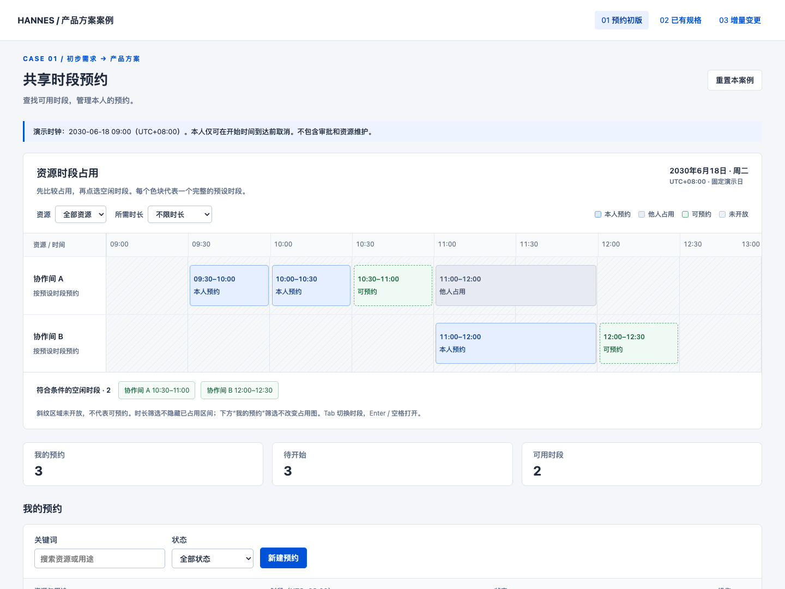
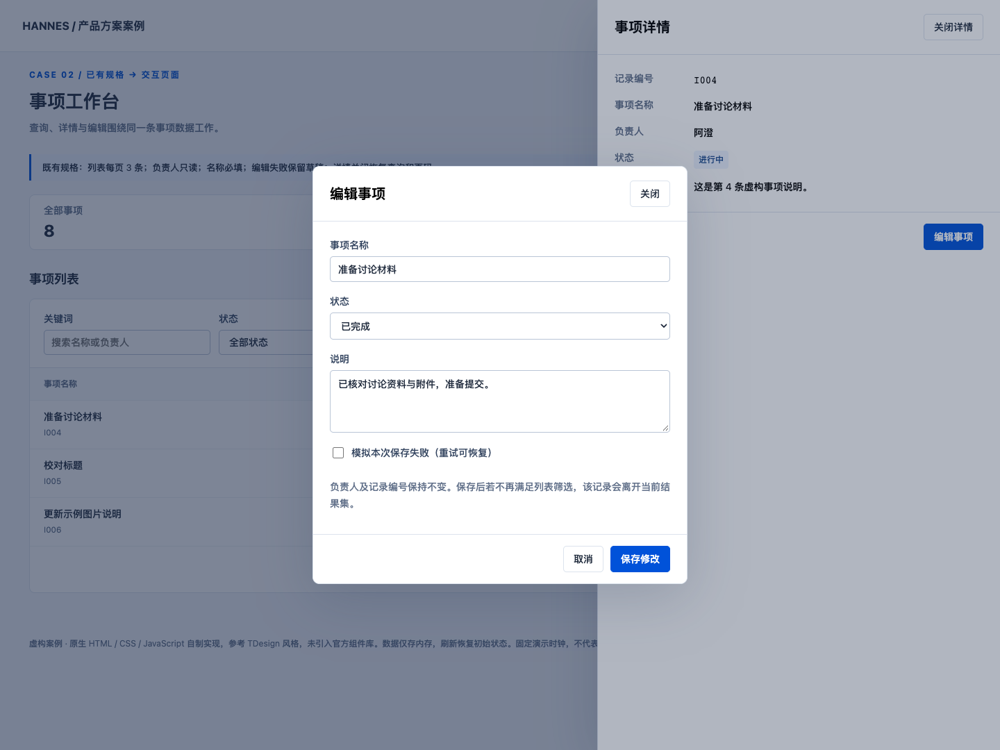
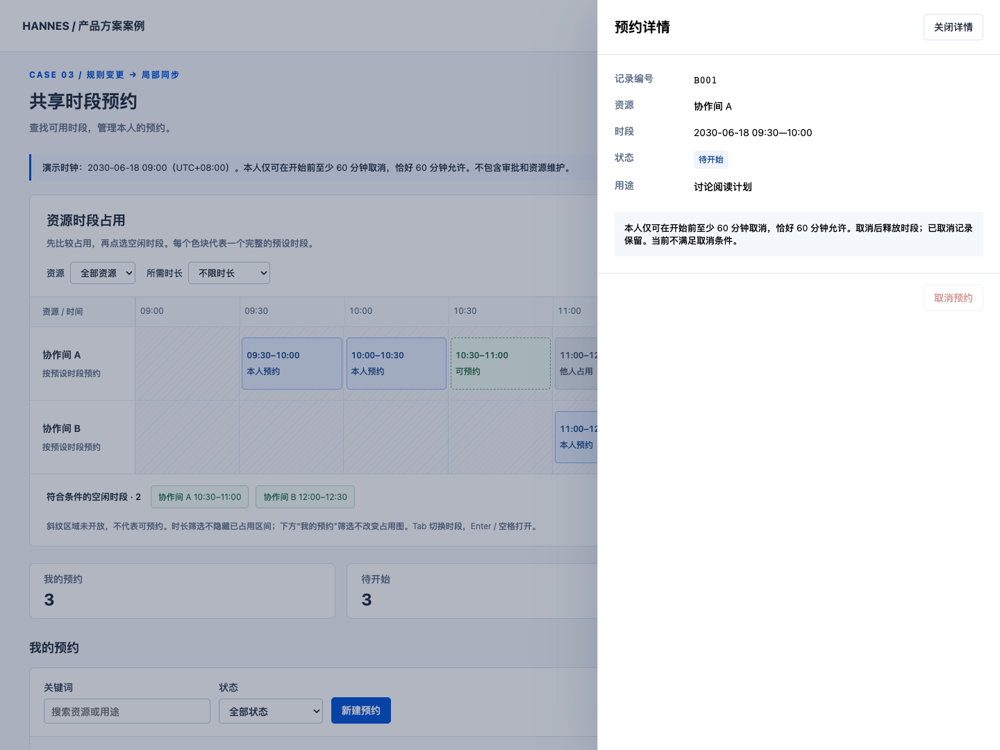

# 三个完整使用案例

所有需求、记录和决定均为自编虚构示例。每个案例包含原始输入、关键取舍、规格与页面对应、操作产物、验收和当前工作状态，可判断需要提供什么、能得到什么。

| 你的起点 | 案例与文档 | 可操作产物 |
| --- | --- | --- |
| 只有需求方向 | [预约初版](reservation.md)：收敛角色和范围、业务规则、任务、流程与页面 | [打开初版](../../assets/examples/product-cases.html?case=reservation-v1#/list) |
| 已有确认规格 | [事项页面](existing-spec.md)：直接复用规格与设计，不重写完整需求 | [打开事项](../../assets/examples/product-cases.html?case=items#/list) |
| 修改规则或局部交互 | [预约增量修改](incremental-change.md)：只同步受影响规则、页面和验收，支持新会话续接 | [打开变更后](../../assets/examples/product-cases.html?case=reservation-v2#/list) |

## 案例截图

以下截图来自随包演示的实际运行，均使用虚构数据；点击前面的案例入口可以继续操作。截图为固定状态展示，不替代交互验收。

### 预约初版：先看占用，再选时段

### 已有规格：列表、详情与编辑

### 增量规则：在详情中解释取消边界

## 复现与维护

1. 下载或完整取用本 Skill 目录，浏览器直接打开 `assets/examples/product-cases.html`，顶部切换三个案例。无需服务器、npm 或运行时网络；文档链接带查询参数以定位相应案例。
2. 按案例中的验证步骤操作，使用“重置本案例”恢复数据。时钟固定为 2030-06-18 09:00（UTC+08:00）；刷新也会重置，不能拿已刷新页面验证原内存记录。
3. 要让助手重做，复制案例的“输入与调用”到自己的项目，提供实际 Skill 路径和目标目录；不要要求写回 Skill 包。已有规格或变更时提供对应文档，沿用同一项目定义。
4. 维护源就是这个单一 HTML。两个预约版本共用数据和取消规则函数，仅阈值和行间距按版本配置；它们是教学对照，不是在真实项目同时维护两份产品规则。事项场景使用独立虚构对象。

预约两个版本包含资源占用时间轴、资源／所需时长筛选、空闲候选与本人记录；明确未开放范围，点选可用块带入完整时段。事项案例仍围绕查询编辑，不强加时间轴。

三案例采用参考 TDesign 的自制 Web 样式和原生控件，不声称使用官方组件库；公共知识见[设计知识](../design-knowledge.json)，实际工程优先沿用自己的组件和参数。现有风格预览及真实 Ant Design 组件目录未改变。

## 验证边界

使用时按各案例的操作步骤检查当前实现。Mermaid 保留可编辑图源；未执行的渲染、真机或真实服务检查不能视为通过。页面中的本地失败开关只说明演示恢复路径，不是接口集成。

## 新会话怎么继续

优先读取案例的“当前工作状态”与有效规则，再提出本次差异。完整目录可脱离仓库根 README 使用；不需要原始聊天。实际项目只有一处状态索引，不因同时使用两种 Skill 创建两套交接资料。
