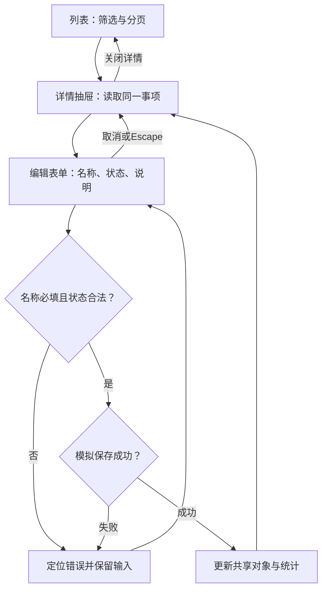

# 案例 02：依据已有规格制作事项页面

## 输入与调用

```text
使用 hannes-requirement-to-design，根据下述已确认规格制作 PC 离线页面。
现有设计基线为参考 TDesign 的浅色列表工作台，使用原生 HTML，直接复用。
只有协作成员角色，本演示当前成员可处理固定示例集合内的全部事项。
列表支持名称/负责人关键词、状态筛选、每页3条、详情和编辑。
编号与负责人不可修改；名称必填，说明可编辑，状态为进行中/已完成。
编辑失败保留草稿；取消不改变记录；保存同步详情、列表和完成数。
关闭详情恢复查询和页码。虚构数据，只存内存；无需新增审批、导出或移动端。
请直接实现关键流程，保留现有规格及设计决定，不再编写另一套完整 PRD。
```

这是完整的虚构输入规格，不需要先调用建模或重新选择风格。实际项目应读取用户已有规格；本文件相当于该项目已有说明。

## 规格到页面和验收的对应

| 有效要求 | 页面／控件 | 可观察结果 |
| --- | --- | --- |
| 名称／负责人搜索、状态筛选 | 列表筛选栏 | 结果与计数同源，改条件回第一页；无匹配明确显示 |
| 每页3条 | 列表分页 | 共8条，翻页不修改记录 |
| 详情定位、返回恢复 | `#/detail/I008` 抽屉 | 关闭恢复查询和页码，未知记录给出回退 |
| 编号／负责人只读 | 详情信息区，编辑中不提供改写控件 | 保存仍保留原值 |
| 名称必填 | 编辑表单 | 拒绝空名称，聚焦错误，原对象不变 |
| 取消与失败保留 | 编辑对话框 | Escape只关闭编辑；取消不提交，失败保留输入并可重试 |
| 保存同步 | 共享事项对象和派生统计 | 详情与列表名称／状态同时改变，完成数重算；不再匹配筛选则移出结果集 |

## 任务流程



不存在跨参与者责任移交，不额外增加泳道。实际页面不把关闭编辑当成业务返回。

## 设计说明与选择依据

沿用 TDesign 风格，不改变现有框架假设。表格适合名称、负责人和状态比较；抽屉保持筛选上下文；三个短字段不拆分步表单。方案使用 `BASE-TDESIGN`、`PAT-LIST`、`PAT-FILTER`、`PAT-DETAIL`、`PAT-FORM`、`QUAL-KEYBOARD`、`QUAL-STATES`，来源见[知识数据](../design-knowledge.json)。

顶部统计针对全部固定集合，列表计数针对当前筛选，两者明确区分。姓名与长标题采用可换行文本，表格过窄时在内部滚动，状态同时提供文字。没有页面局部覆盖，不因案例示例强制真实产品固定布局。

## 产物与复现步骤

[打开事项原型](../../assets/examples/product-cases.html?case=items#/list)。初始8条、完成1条；原生 HTML 为维护源，无依赖安装。

1. 重置，搜索“阿澄”：共4条；翻到第2页并查看 I008。
2. 编辑名称留空，保存应被阻止；填临时名称后 Escape，详情仍为原值。
3. 再编辑，改名与状态，勾选模拟失败，失败后输入仍在；重试，详情更新且完成数增加1。
4. 关闭详情：关键词与第2页保留；列表展示同一新名称。若更改令记录不再匹配条件，列表相应移除并修正页码，不留伪记录。
5. 搜索不存在关键词查看空态，打开未知 ID 检查回退，重置还原数据。

可按上述步骤操作并检查当前页面行为。本演示未实现持久化、真实权限、上传、登录或多用户协作。

## 当前工作状态（案例）

- 有效依据：本文件输入规格与对应表，设计说明沿用现有参考 TDesign 基线。
- 已确认：协作成员、固定集合可编辑、名称必填、负责人／编号只读、PC、每页3条。
- 已完成：列表、筛选、分页、详情、编辑及本地恢复与同步演示。
- 维护／预览：`assets/examples/product-cases.html`；直接打开“02 已有规格”，无构建，刷新重置。
- 未决：真实账号数据范围不在演示约定中，不据此宣称所有真实用户均可编辑。
- 验证：见随包验证记录；Mermaid未渲染、真实服务和真人可用性未测。
- 下一步：有变更时改原规格和对应交互，只复核受影响路径；不重做全部角色和 PRD。
