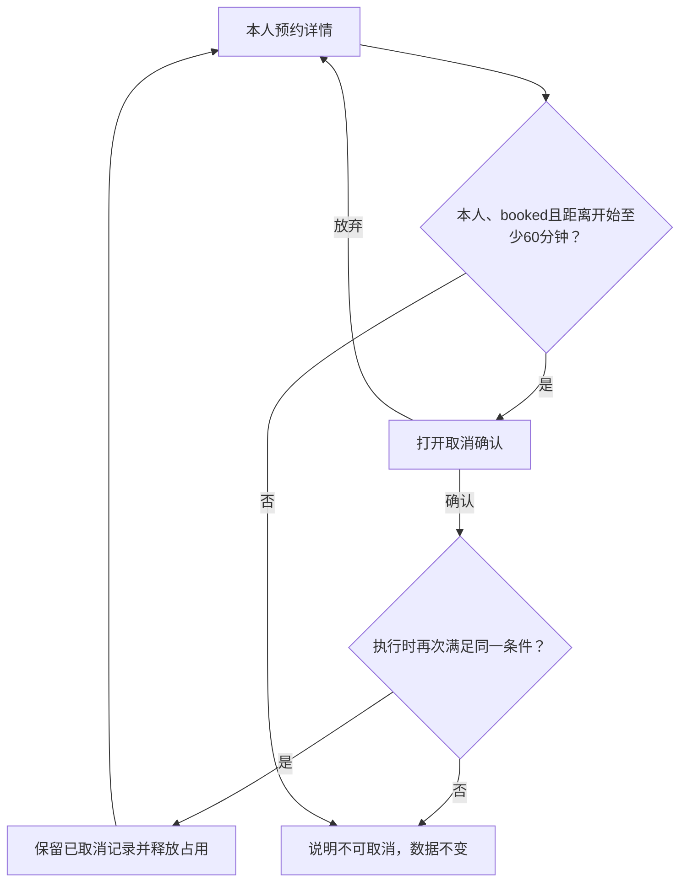

# 案例 03：新会话继续，修改取消规则与局部间距

## 输入与调用

```text
这是新会话，请使用 hannes-requirement-to-design，
先读取预约项目当前工作状态及有效规格，不读取旧聊天。
沿用PC、参考TDesign、单一成员角色和离线原生实现。
本次取消条件改为开始前至少60分钟，恰好60分钟允许；其他规则不变。
预约列表单元格上下内边距由12px改为16px，其他页面继承原值。
仅更新相关规格、流程、提示、动作判断和验证记录，不重新设计全部页面。
```

基线是[预约初版](reservation.md)中的 R1—R6、任务和设计说明，不以旧页面按钮当前是否可点覆盖新确认条件。没有其他资料或聊天也能定位维护源和预览入口。

## 变更与影响

| 项目 | 原值 | 本次有效值／影响 |
| --- | --- | --- |
| R4取消时间 | `now < start` | `start - now >= 60 分钟`；恰好60允许，仍要求本人和booked |
| 用户流程判断 | 未开始即可 | 改为满足60分钟阈值；失败说明原因，数据不变 |
| 详情动作与提示 | 初版条件 | 按同一函数禁用／校验；说明新阈值，不能只改按钮样式 |
| 取消结果 | 保留记录、释放占用 | 不变；只有合法取消才触发 |
| 列表间距 | 全局12px | 仅本版本预约列表上下16px；未列项继续继承 |
| 数据范围与其他任务 | 仅本人；原创建规则 | 不变；不增加管理员、权限例外或通知 |

真实项目应在同一份现有规格原处替换 R4；本文件保留前后对照只为教学。未受影响规则仍由初版定义并引用，不另抄一套矛盾的权限或状态。

## 更新后的流程图源



两个版本现共用优化后的占用视图及空闲选择，不将这次共同案例改进混入60分钟业务变更：资源、预设窗口、本人范围和冲突规则不变。取消后同步占用块、空闲候选和统计；时长筛选不改变取消资格。

预约创建主流程没有变化，无须重画整份流程，也不因单元格间距调整重建角色和 PRD。图源未渲染。

## 设计说明的页面局部覆盖

| 页面 | 覆盖项 | 原值 | 新值 | 原因 | 范围 | 状态 |
| --- | --- | --- | --- | --- | --- | --- |
| 预约列表，增量案例版本 | 单元格上下内边距 | 全局12px | 16px | 已确认增加行间阅读空间 | 仅该版本列表；不含事项页、抽屉和表单 | 虚构输入已确认 |

其余继承全局参考 TDesign 基线。取消阈值属于业务规则，在 PRD 定义；不将其放入视觉覆盖。知识引用 `PAT-LIST`、`PAT-CONFIRM`、`QUAL-DENSITY`，依据见[知识数据](../design-knowledge.json)。

## 产物与复现步骤

[打开变更后的原型](../../assets/examples/product-cases.html?case=reservation-v2#/list)。两个预约版本由同一维护源的模式配置驱动，避免分别修复两份相同交互。

1. 重置并查看 B001（09:30开始）：距09:00仅30分钟，不可取消。
2. 查看 B002（10:00开始）：恰好60分钟可取消；确认后详情、待开始数和可用时段同步。
3. B003（11:00开始）可取消；已取消对象不可重复执行，B004不属于本人不可读取。
4. 对照初版 B001 可取消，验证规则变化实际进入动作判断；其余创建、冲突与本人范围不变。
5. 在时间轴打开B002并取消，确认该块改成可预约、相应空闲候选增加，仍保留本人取消历史；B001不能因图上点击绕过60分钟条件。
6. 检查本版列表行上下16px，初版和事项仍12px，抽屉和表单未覆盖。

按上述步骤检查当前实现；浏览器操作不代表真实服务或 Skill 的普遍效果已获验证。

## 当前工作状态（案例变更后）

- 有效依据：本文件替换初版 R4；其他规则仍引用初版。当前演示入口为 `reservation-v2`。
- 已确认：60分钟包含边界、本人范围不变、仅该列表间距12→16；无需重选风格。
- 已完成：本地模式配置、条件与提示、局部设计覆盖及关联任务验收。
- 维护／预览：`assets/examples/product-cases.html` 为唯一维护源，直接选择“03 增量变更”。
- 未决：真实时钟与服务端校验不在本次范围；演示固定时钟不等于真实生产时间规则完成。
- 验证：按以上步骤在当前环境检查；图形、真实服务及真机能力需分别验证。
- 下一步：目标项目若正式采用此规则，在该项目原规格更新；不要把教学初版同时作为有效规则。
