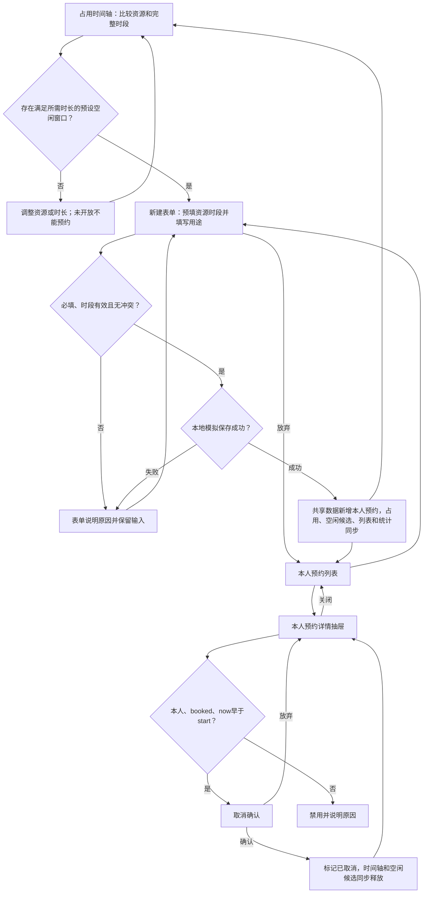

# 案例 01：从初步预约需求形成可讨论方案

## 输入与调用

```text
使用 hannes-requirement-to-design，必要时按需使用可用的 hannes-product-modeling。
成员比较多个共享资源的时段占用，找出满足所需时长的预设空闲窗口并预约，查看和取消自己的预约。
用资源×时间可视化展示占用，点击空闲窗口带入表单；未开放区域不能预约。
只有成员角色，不涉及审批或资源维护。预约时需要填写用途，用途必填。
本人仅能取消尚未开始的预约，
取消释放占用，重复取消不重复释放；失败保留输入，不产生记录。
制作 PC 离线演示，已选参考 TDesign 的 Web 风格，允许原生 HTML 实现。
时钟固定 2030-06-18 09:00（UTC+08:00），用虚构数据，不做接口和持久化。
请将范围、规则、任务和流程、页面规格、设计理由及工作状态写到项目说明，
实现可操作页面，实际验证并说明限制，不重复询问上述决定。
```

## 范围与关键决定

主任务先是比较资源占用、找到可预约的完整窗口，然后创建与本人取消。只纳入预设资源／时段、本人预约、冲突反馈与取消确认；优先确保闭环，不增加人工角色、审核链、手机流程、通知、支付或资源维护。系统校验属于自动行为。

所有页面读取同一内存数据。公共资源占用只显示可用性，本人预约列表与详情不泄露他人用途。生产身份、服务端权限与并发保障均未实现。

## PRD：对象与有效规则（初版）

| 规则 | 定义 |
| --- | --- |
| R1 归属 | 固定当前成员 `me`；仅本人预约可进入列表与详情。其他成员占用只影响可用性 |
| R2 创建 | 选择预设未来时段并填写用途；提交重新校验，成功只产生一条本人 `booked` 记录 |
| R3 冲突 | 同资源的活动预约采用半开区间；`a.start < b.end && b.start < a.end` 为重叠；不同资源不互斥 |
| R4 取消 | 本人、`booked` 且 `now < start` 才能取消；确认后改为 `cancelled`，保留记录，空闲重算；重复不可再次执行 |
| R5 恢复 | 失败不生成记录，保留输入；关闭表单或确认框不改变业务数据 |
| R6 演示 | 固定时钟、UTC+08:00；数据仅内存，刷新与重置还原。用途必填为本虚构需求的确认条件 |

初始本人记录 B001／B002／B003，分别开始于09:30／10:00／11:00；另一个成员的 B004 只参与占用判断。共六个预设时段，初始可用两个：A 的10:30—11:00，B 的12:00—12:30。占用图查看09:00—13:00，其余斜纹区未开放；它不是全天可用性承诺。不支持跨窗口拼接、任意起止或跨日选择。详情深链 `#/detail/B001`；他人或未知标识显示“记录不存在”。

## PRD：任务、流程与页面

| 核心任务 | 入口与信息 | 主要步骤与结果 | 取消／失败／恢复 |
| --- | --- | --- | --- |
| 查找空闲 | 占用时间轴；日期、时区、资源、占用及预设窗口 | 比较资源并按所需时长筛选；点击可预约块或空闲候选 | 未开放不能操作；无匹配可调整条件；占用块不因时长筛选消失 |
| 创建预约 | 时间轴空闲块／候选，或“新建预约”；资源、完整时段与可用状态 | 从空闲块预填时段、填写用途、提交；占用、候选、列表及可用数同步 | 用途为空聚焦错误；冲突保留用途并改选；模拟保存失败可原地重试；放弃无变化 |
| 查看本人预约 | 列表“查看详情”或有效深链 | 详情抽屉查看同一记录 | 关闭恢复列表条件与页码；未知／非本人有回退 |
| 取消预约 | 本人可取消详情 | 确认影响后取消，保留历史并释放时段 | 放弃无变化；非法时间／状态拒绝，不泄露他人数据 |



同一成员承担全部人工步骤，没有责任移交，因此不用人为拆泳道。图源可编辑，未实际渲染；页面运行验证与图形验证分开。

## 设计说明

- 全局基线：PC、参考 TDesign 的浅色工作台，沿用随包[规范](../../design-spec.md)对应基线；参数只在页面共享变量维护。自制实现，不引入官方运行时。
- 页面选择：以资源为行、同一时间标尺为列展示占用，区间块宽度对应完整预设时长，优先支持查空闲；表格用于本人记录与状态管理，不能代替空闲判断。空闲块／候选预填表单，本人占用块打开详情；他人块只说明占用，不提供身份、用途或取消。短预约与确认保留对话框。引用 `PAT-SCHEDULE`、`BASE-TDESIGN`、`PAT-LIST`、`PAT-DETAIL`、`PAT-FORM`、`PAT-CONFIRM`、`PAT-FEEDBACK`，来源及适用限制见[知识数据](../design-knowledge.json)。
- 信息优先级：先资源／时间与可用性，再本人记录。资源和最短时长仅筛选占用图与候选，不隐藏已占用；下方关键词／状态只筛本人记录，页面明确标注。未开放用斜纹和文字，其他状态同时有文字。时间块和候选均可键盘操作；资源标签在横向滚动时保持。取消及保存后优先回到仍有效的原入口，入口因状态变化消失时回到新建等稳定入口。本人记录展示资源／用途、完整时段、状态与操作；取消条件在详情直接说明，风险不只靠颜色。
- 全局列表单元格上下内边距为 12px，初版无页面覆盖。这里只定义虚构项目参数，不把自选值称为官方唯一标准。

## 产物与复现步骤

[打开初版原型](../../assets/examples/product-cases.html?case=reservation-v1#/list)。列表支持关键词、状态和分页；详情通过独立 Hash 定位；表单与列表使用同一事实源。

1. 重置先看同一时间轴，找出A 10:30—11:00与B 12:00—12:30两个空闲窗口，核对本人3条、待开始3条、可用2。选择至少60分钟，应无可用候选，但本人／他人占用仍显示；未开放斜纹不提供预约入口。
2. 改回不限时长，用键盘选择A的空闲块，确认表单预填S3；取消表单不改数据。打开他人占用块，只显示资源和区间，不能查看身份／用途或取消。
3. 查看 B001 → 取消预约 → 放弃，确认数据未变；再确认取消，待开始变2，可用变3，原记录保留。
4. 新建预约先提交空用途，看到必填；填写后选已占用时段，冲突保留输入；选已释放时段，勾选模拟失败，失败后重试成功。
5. 检查本人预约增加一条、可用数回落；打开 B004 深链应不可读取其个人记录。
6. 刷新或重置恢复数据。以上为案例验收步骤，不代表已在使用者当前环境执行通过。

## 当前工作状态（案例初版）

- 有效依据：本文件 R1—R6、任务与设计说明；只适用于 `reservation-v1`。
- 已确认：单一成员、无审批、PC、参考 TDesign、自制离线实现与内存数据。
- 已完成：规格、流程图源、资源占用视图与可操作原型；不代表真实服务完成。
- 维护／预览：`assets/examples/product-cases.html` 为维护源；直接打开并选“01 预约初版”，无需构建。相对入口以本 Skill 根为准。
- 未决与边界：真实服务时钟、服务端权限和并发不在本次范围，未增加实现要求。
- 验证：实际方式和覆盖见验证记录；图源尚未渲染，真实服务未测。
- 下一步：如采用[增量取消规则](incremental-change.md)，仅更新受影响 R4、流程判断、详情动作及相关验收，不重新收集已确认方向。
