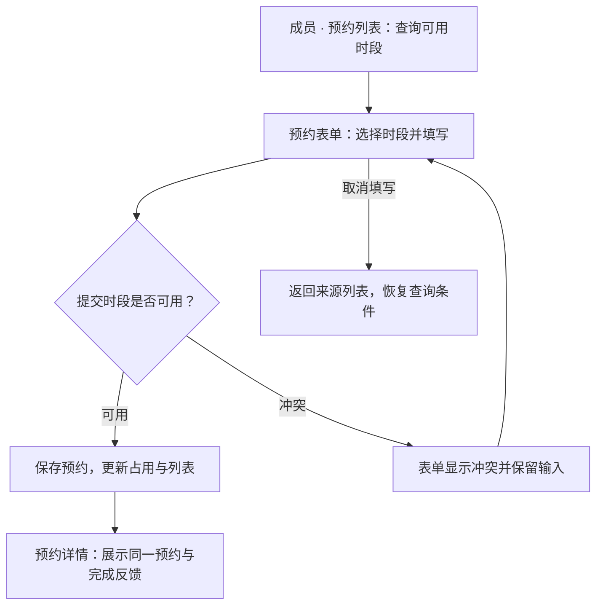
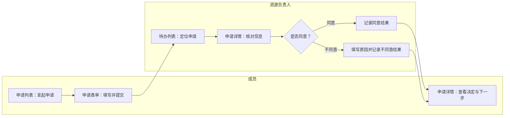

# 需求、执行基线与页面规格

围绕核心任务说明用户需要判断的信息及其表达：查空闲要提供资源、完整时间、占用与可用范围，不能只有本人记录；页面选择依据见[任务与信息表达](task-representation.md)。不因示例使用时间轴就新增任意时长、跨日预约或资源维护范围。

## 输入与依据

从用户实际给出的材料开始，不要求先提供格式完整的需求文件。检查相关目录与现有成果，建立当前任务需要的简短清单：

| 依据 | 需要明确的内容 |
| --- | --- |
| 本次目标 | 用户要评审什么、目标端、版本范围、交付方式 |
| 业务依据 | 当前确认的需求、规则、规格及其适用范围 |
| 视觉依据 | 当前项目规范、用户确认参考或选定模板 |
| 实现依据 | 可复用项目、路由、组件、数据适配与运行方式 |
| 决策状态 | 已确认、待确认、建议、已废弃，以及对应来源 |

没有统一的“文件名越新越优先”规则。按用户指定的版本和材料职责确定依据；总览、分模块规格、旧版迁移材料不能相互越权覆盖。重要冲突提问，不影响当前任务的缺口列为假设并继续。

## 围绕核心任务收敛范围

从已有参与者和用户要完成的任务开始，不先罗列岗位再发明功能。仅在处理责任、决策权限或数据访问存在实质差异时拆角色，并说明依据；同一角色可以承担多个步骤。同名角色有实质权限差异时用职责或数据范围区分，不能为减少人数而合并冲突权限。

先跑通主流程，例外角色按明确需求补充。缺失责任列为待确认，不自行生成管理员或多级审核；自动处理属于系统行为，不默认增加人工岗位或管理页面。

按当前任务记录以下范围信息，可放入已有规格或简短清单，不强制新增文档：

| 范围项 | 需要表达 |
| --- | --- |
| 核心任务 | 谁在何种情境下要获得什么结果 |
| 功能与内容 | 必要操作，以及理解信息、作出判断所需的内容、来源与口径 |
| 版本边界 | 本次纳入、明确排除、延期事项及必要依赖 |
| 优先级 | 当前用户价值、业务必要性、依赖或风险依据，不虚构调研与排序数据 |
| 验收预期 | 可观察的完成结果，已确认要求与演示假设分别标明 |

## 按任务控制规格深度

- 小修改：变更点、影响页面和预期行为即可，不重建整套 PRD。
- 普通页面：页面目标、字段与动作、成功/失败反馈、必要状态。
- 复杂系统：页面清单与职责、角色和对象关系、导航、页面规格、跨页业务闭环、范围边界与覆盖关系。明确哪些页面属于当前版本，菜单与直接路由一致。

复杂业务规则可交给可用的 `hannes-product-modeling` 做局部分析。只传当前问题和必要材料，回收规则、未决项和影响范围；不要求其输出固定协议或依赖本工作流。业务规则未确认时，用可替换的演示假设供评审，不把猜测固化为需求。

与建模 Skill 协作时，业务模型、规则与页面规格可以分文件组织，但沿用同一项目基线。将分析结果更新到现有定义处，页面引用相关规则；由本 Skill 维护协作项目的页面表达，不复制一套相同规则另行维护。

## 用户任务与流程图

先描述任务，再决定页面。每项核心任务写清使用角色、触发情境、入口、必要信息、主要步骤、关键判断和完成结果，以及本次有关的取消、失败与恢复路径。步骤引用已有业务规则，并对应页面或交互单元；命名沿用项目约定，不强制编号体系。

新建或重构核心流程时，在 PRD 中保留 Mermaid 图源。单一用户的连续操作用流程图；有不同参与者责任移交时，用 `flowchart` 的 `subgraph` 分区表达泳道。泳道对应实际责任主体，系统泳道只承载有依据的自动处理。不同页面不等于不同泳道，同一角色的多个步骤也不拆成多个角色。

图示覆盖当前主路径和有关分支。判断边写条件，结束节点表达业务结果；恢复路径返回明确步骤。图、任务文字、业务规则、状态和页面映射应一致；复杂对象生命周期另用状态机。渲染能力可用时实际预览，无法渲染时准确说明只交付图源。局部流程变更只修改受影响部分，纯视觉调整不重画流程。

### 单一用户任务示例

以下为虚构的已确认示例：成员查询时段并提交预约；系统校验时段可用性，冲突时保留输入供修改。不额外设置审核角色。节点中的页面名称用于映射交互，不规定实际路由命名。

### 跨参与者协作示例

仅当当前业务已明确“成员申请由资源负责人决定”时，才使用下例中的两个角色。该设定不作为预约业务的默认要求；不同意见的规则与结果应先在项目中明确。

此示例只表达已确认的责任移交和决定结果；不凭图中的按钮增加复审、申诉或自动通知。项目涉及补充材料、并发决定或撤回时，再补充相应规则和路径。

## 页面级规格

按需使用以下四部分，保留当前问题真正需要的细节：

1. **页面说明：** 目的、进入方式、页面职责、布局、字段和关联页面。
2. **数据流转：** 数据来自哪个对象、读取条件、编辑暂存、提交后变化、其他页面如何读取；说明模拟或真实接口。
3. **操作说明：** 触发入口、角色/数据范围、校验、成功结果、失败反馈、取消与返回、后续去向。
4. **判断逻辑：** 页面可见、数据可见、字段可编辑、动作可执行分别判断；状态与前置条件、空态、异常、对象不存在及必要的重复提交防护。

关键流程保持“需求 → 页面/状态 → 操作 → 验证”的可追溯关系，使用现有编号或自然名称即可，不强制额外编号体系。示例：创建事项后列表出现同一对象；详情保存后列表和筛选结果更新；无权限状态不能仍允许执行修改动作。

## 截图与多份参考

- 清点全部输入图片，区分页面、组件、局部状态；记录来源到页面/状态的对应关系。
- 相同截图承载不同路由或状态时保留对应关系，不能按图片去重丢页面。
- 截图约束视觉事实，不自动证明权限、数据来源或点击结果。缺失的规则依据需求确认。
- 缺稿、推导页面及交互假设分别标注；不能称为原图还原或已确认设计。
- 参考之间冲突时说明适用范围，不把不同时期或不同端的界面随意混合。

## 增量变更

先识别变化属于业务、权限/状态、导航/返回、视觉还是打包。涉及角色责任或核心任务时同步相关文字、流程图与页面映射；局部变更不重建全部角色，纯视觉变更不重画流程。业务变化同步受影响规格与演示数据；视觉变化优先改共享变量/组件；打包变化更新运行说明及对应验证。只修改被授权的范围，保留已确认术语与已有正常行为。

## 后续维护

复杂项目交付时在现有说明中按[项目续接](project-continuity.md)更新当前工作状态。它索引本规格和已有设计说明，不复制规则；新会话先核对有效版本，只调整本次变化。完整[案例](examples/README.md)展示输入到规格及原型的对应。
